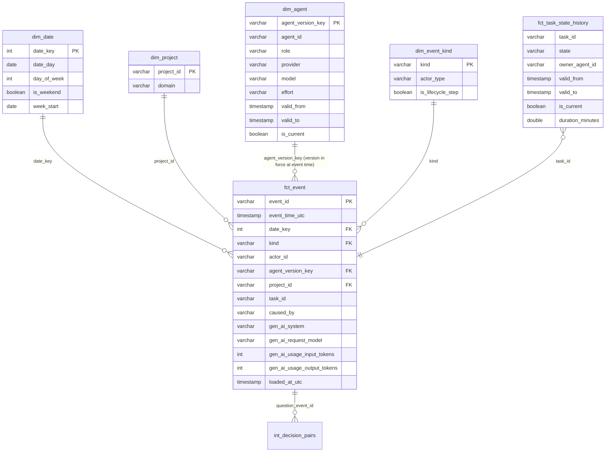

# Tables, grain and keys

| Model | Grain | Built as |
|---|---|---|
| `stg_events` | one event_id (first delivery) | view |
| `stg_events__rejected` | one malformed landed row | view |
| `fct_event` | one event | incremental table |
| `fct_task_state_history` | one task state interval | table |
| `dim_agent` | one agent model/effort version | table |
| `int_decision_pairs` | one answered question | view |
| `int_work_sessions` | one work session | view |
| `mart_*` | one day, one stage or one summary row | table |
